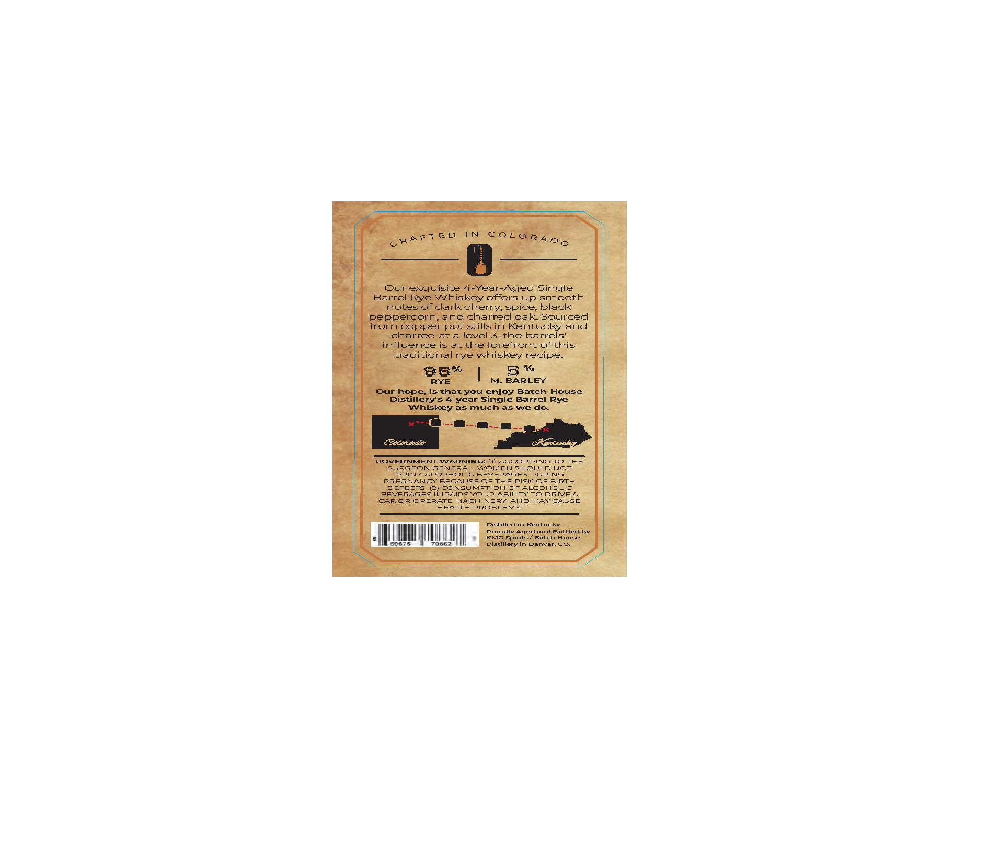
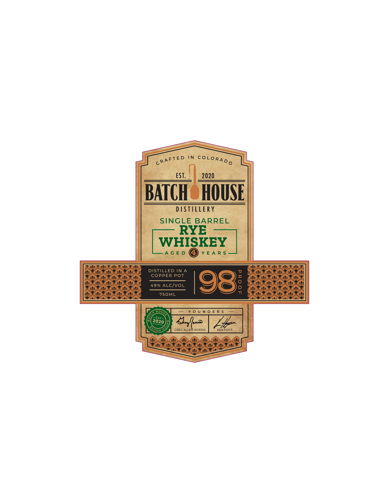

# TTB COLA Label Images - TTBID 26321001000683

**Brand Name:** SINGLE BARREL
RYE WHISKEY

**Issue Date:** 11/20/2026

**Origin Code:** 13

**Product Class/Type:** 142

**Source:** [TTB Public COLA Registry](https://ttbonline.gov/colasonline/viewColaDetails.do?action=publicFormDisplay&ttbid=26321001000683)

## Label Images

### Back Label

### Front Label

## Extracted Label Text

*Text extracted via OCR - may contain errors*

**Detected Proof:** 95

### Back Label

I N
Our exquisite 4-Year-Aged Single
Barrel Rye Whiskey offers Up smooth
notes of dark cherry, spice; black
peppercorn, and charred
oak_
Sourced
from
copper
stills in Kentucky and
charred
ata
level 3,
the barrels'
influence is attheforefront ofthis
traditional rye whiskey recipe:
95%
5 %
RYE
BARLEY
Our hope,is thatyou enjcy Batch
House
istillery's 4-year Single
Barrel Rye
Whiskey as much as we
do
Celetaae
Rarztae
GOVERNMENT WARNING: (1}
ACCORDINGTOTHE
SURGEONGENERAL
VVOMENSHOULD
NOT
DRINKALCOHOLIC BEVERAGES DURING
PREGNANCY BECAUSEOFTHERISKOF BIRTH
DEFECTS_
(2} CONSUMPTIONOFALCOHOLIC
BEVERAGESIMPAIRSYOURABILITYTODRIVE
CAROR
OPERATE MACHINERY
KND
MAY CAUSE
HEALTH PROBLEMS_
Distilled
Kentucky
Proudly Aged and Bottled by
KMC Spirits
Batch House
47275
Helee
Distillery in Denver_
Co.
coloRA Do
R AFt E D
pot

### Front Label

IN
EST:
2020
BATCh
HOUSE
DSTILLERY
SINGLE
BARREL
RYE
WHISKEY
A G E
D
Y E A R $
DISTILLED IN A
COPPER
POt
49% ALCIvoL
198
750ML
A
F 0 U N D E R $
4
Iau
S
K
GREG ALLEN NORRIS
KEN HOYT
CoLoRAD0
c RAFTE D
HousZ
=EST=
2020
noh
