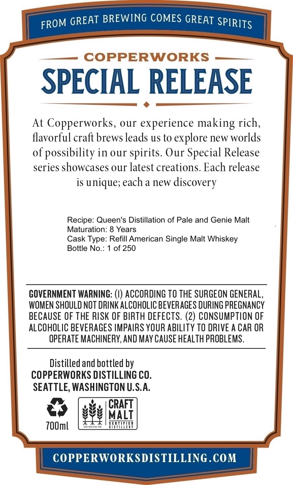
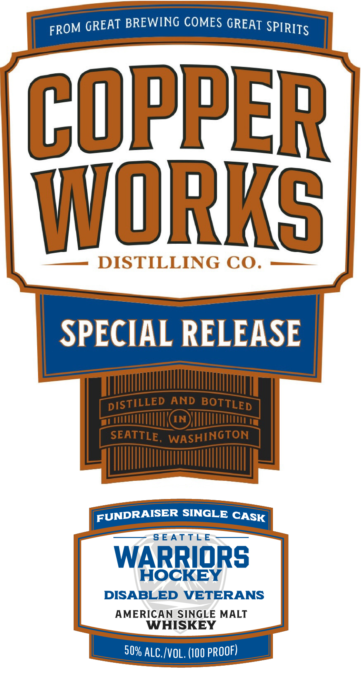

# TTB COLA Label Images - TTBID 26321001000752

**Brand Name:** COPPERWORKS DISTILLING CO.

**Fanciful Name:** WARRIORS HOCKEY

**Issue Date:** 11/24/2026

**Origin Code:** 07

**Product Class/Type:** 140

**Source:** [TTB Public COLA Registry](https://ttbonline.gov/colasonline/viewColaDetails.do?action=publicFormDisplay&ttbid=26321001000752)

## Label Images

### Back Label

### Label 1

## Extracted Label Text

*Text extracted via OCR - may contain errors*

**Detected Proof:** 100
**Detected Age:** 8 Years

### Back Label

GREAT BREWING COMES GREAT
COPPERWORKS
SPECIAL RELEASE
At Copperworks, our
experience making rich,
flavorful craft brews leads us to explore new worlds
of possibility in our
Our Special Release
series showcases our latest creations. Each release
is
each a new discovery
Recipe: Queen's Distillation of Pale and Genie Malt
Maturation: 8 Years
Cask Type: Refill American Single Malt Whiskey
Bottle No.=
of 250
GOVERNMENT WARNING:
ACCORDING TO THE SURGEON GeNERAL,
WOMEN SHOULD NOT DRINK ALCOHOLIC BEVERAGES DURING PREGNANCY
BECAUSE OF THE RISK OF BIRTH DEFECTS. (2) CONSUMPTION OF
ALCOHOLIC BEVERAGES IMPAIRS YOUR AbILITY TO DRIVE A CAR OR
OPERATE MACHINERY, AND May CAUSE HEALTH PROBLEMS ,
Distilledand bottled by
COPPERWORKS DISTILLING CO,
SEATTLE; WASHINGTON U.S.A:
CRAFT
MALT
7OOml
EUELIEEe
HMHHF
COPPERWORKSDISTILLING.COM
SPIRITS
FROM
spirits.
unique;

### Label 1

FROM GREAT BREWING COMES GREAT
COPPER
WORKS
DISTILLING CO
SPECIAL RELEASE
AND
SEATTLE, WASHINGTON
FUNDRAISER SINGLE
s EATTE
WARRIORS
HOCKEY
DISABLED
VETERANS
AMERICAN SINGLE MALT
WHISKEY
50% ALC_ /voL, (100
SPIRITS
DISTILLED
BOTTLED
CASK
PROOF)
