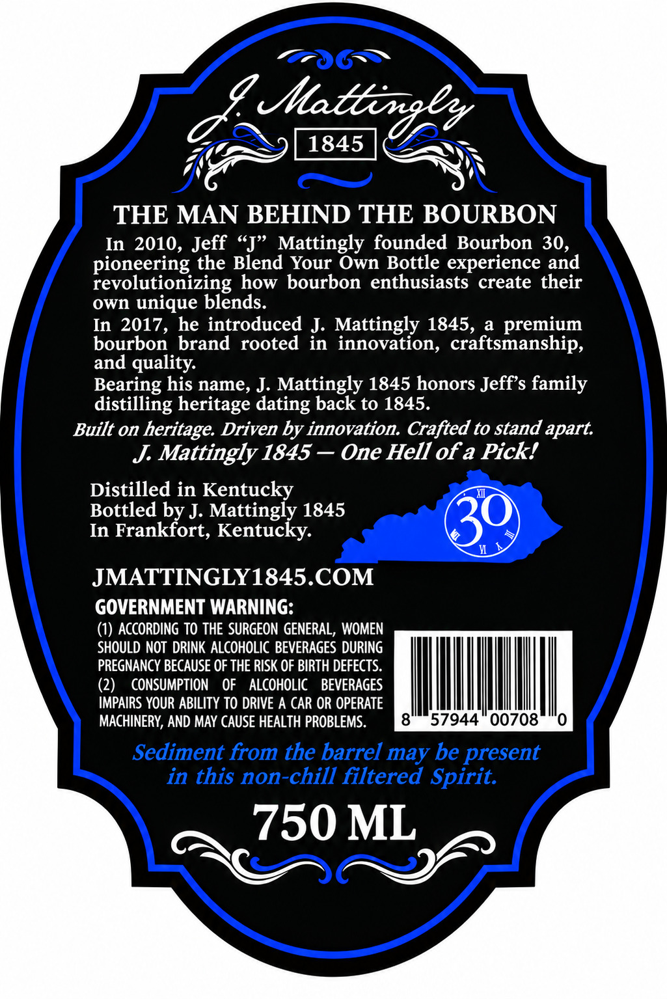
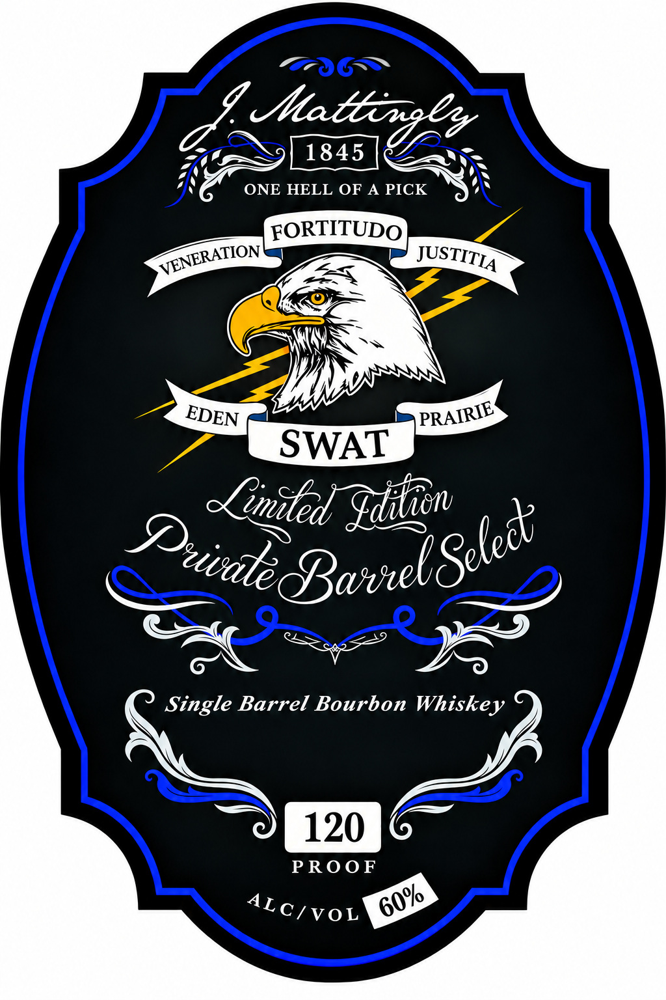

# TTB COLA Label Images - TTBID 26321001000807

**Brand Name:** J. MATTINGLY 1845

**Issue Date:** 11/24/2026

**Origin Code:** 22

**Product Class/Type:** 141

**Source:** [TTB Public COLA Registry](https://ttbonline.gov/colasonline/viewColaDetails.do?action=publicFormDisplay&ttbid=26321001000807)

## Label Images

### Back Label

### Front Label

## Extracted Label Text

*Text extracted via OCR - may contain errors*

**Detected Proof:** 120

### Back Label

"~tattraey
1845
THE MAN BEHIND THE BOURBON
In 2010, Jeff %J" Mattingly founded Bourbon 30,
pioneering the Blend Your Own Bottle experience and
revolutionizing how bourbon enthusiasts create their
own unique blends.
In 2017, he introduced J Mattingly 1845,
a
premium
bourbon brand rooted in innovation, craftsmanship,
and quality
Bearing his name, J: Mattingly 1845 honors Jeff's family
distilling heritage dating back to 1845.
Built on heritage. Driven by innovation. Crafted to stand apart
J. Mattingly 1845
S
One Hell of a Pick!
Distilled in Kentucky
Bottled by J Mattingly 1845
In Frankfort, Kentucky:
JMATTINGLY1845.COM
GOVERNMENT WARNING:
(1) ACCORDING TO THE  SURGEON  GENERAL, WOMEN
SHOULD NOT  DRINK ALCOHOLIC BEVERAGES DURING
PREGNANCY BECAUSE OF THE RISK OF BIRTH DEFECTS:
(2)
CONSUMPTION
OF
ALCOHOLIC
BEVERAGES
IMPAIRS YOUR ABILITY TO DRIVE A CAR OR OPERATE
MACHINERY, AND MAY CAUSE HEALTH PROBLEMS:
8
57944" 00708
0
Sediment from the barrel may be present
in this non-chill filtered Spirit:
750 ML

### Front Label

batteaez
1845
ONE HELL OF
A PICK
FORTITUDO
SWAT
Single Barrel Bourbon Whiskey
120
PROOF
VENERATION(
JUSTITIA
PRAIRIE
EDEN
Fdilion
Jimdled
Bwvel Seled:
Dualec
60%
ALC /VOL
