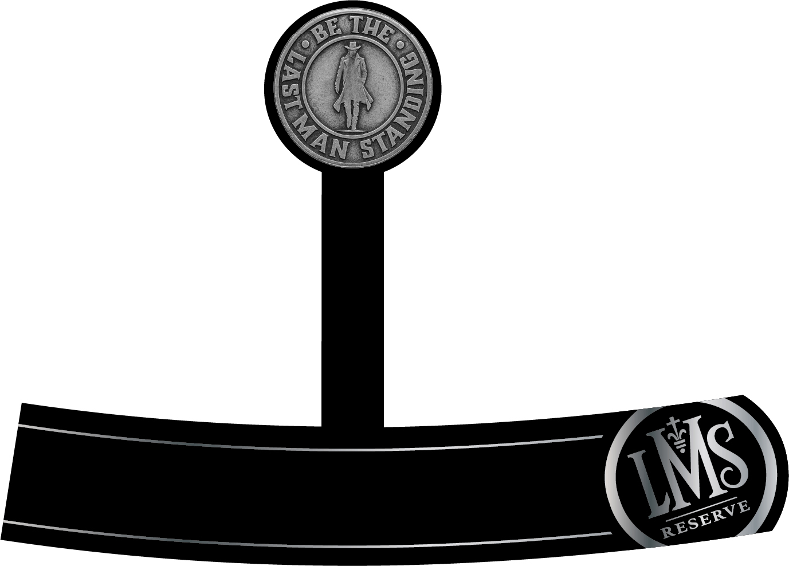
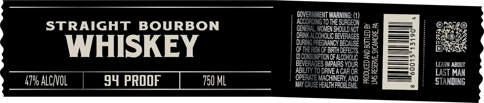

# TTB COLA Label Images - TTBID 26321001000810

**Brand Name:** LAST MAN STANDING

**Fanciful Name:** THE FINAL PROOF

**Issue Date:** 11/24/2026

**Origin Code:** 39

**Product Class/Type:** 101

**Source:** [TTB Public COLA Registry](https://ttbonline.gov/colasonline/viewColaDetails.do?action=publicFormDisplay&ttbid=26321001000810)

## Label Images

### Back Label

### Front Label

### Label 3

## Extracted Label Text

*Text extracted via OCR - may contain errors*

*1 image(s) excluded: text did not meet readability threshold*

**Detected Proof:** 94

### Back Label

BE
THB
STANO
MAn
IMS
RESERVE

### Front Label

GOVES

MENT WARNING: (1)

NG TO THE SURGEON

STRAIGHT BOURBON

GENER

WOMEN SHOULD NOT

a

Eats

— O

janes

DRINK

COHOLIC BEVERAGES

=|

ee

——a OF

Rat

DURING

REGNANCY BECAUSE

5S

——~-

OFTHE

SK OF BIRTH DEFECTS,

aa

fol

WHISKEY

(CON

MPTION OF ALCOHOLIC

aoe

ur

—c-

BEV

GES IMPAIRS YOUR

mu

On

og

en

LEARN ABOUT

ABILIT

(0 DRIVEA CAR OR

ae

| __y

LAST MAN

47% ALCIVOL

MAY CA

OPER!

E MACHINERY, AND

[Wi |

STANDING

94 PROOF 750 ML

3E HEALTH PROBLEMS,
