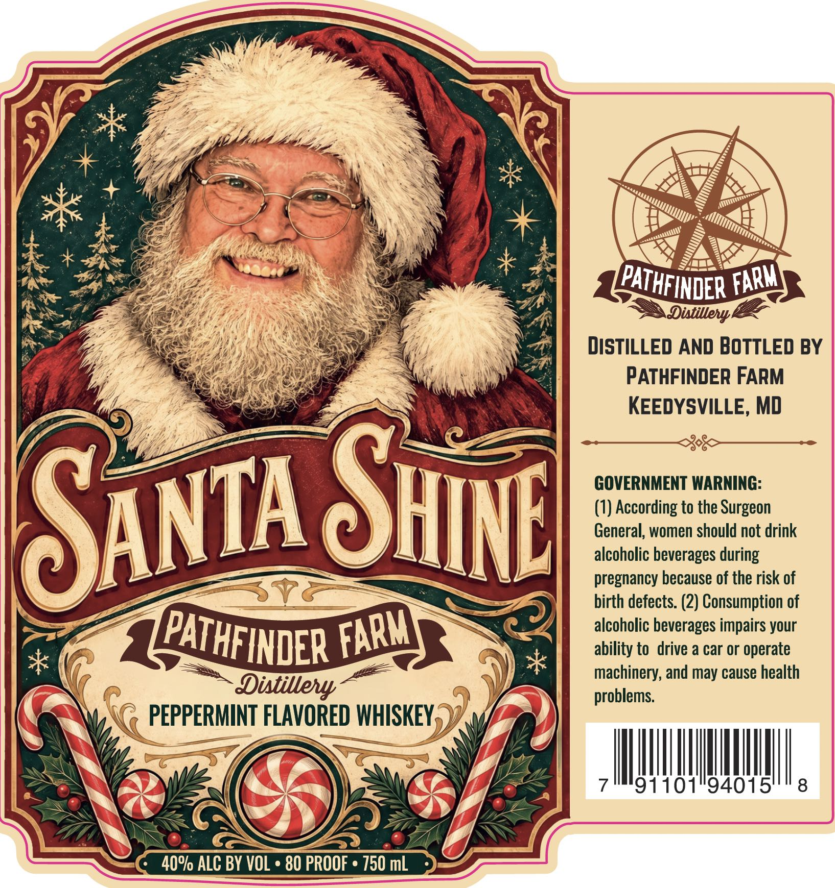

# TTB COLA Label Images - TTBID 26321001000827

**Brand Name:** PATHFINDER FARM

**Issue Date:** 11/24/2026

**Origin Code:** 25

**Product Class/Type:** 149

**Source:** [TTB Public COLA Registry](https://ttbonline.gov/colasonline/viewColaDetails.do?action=publicFormDisplay&ttbid=26321001000827)

## Label Images

### Front Label

## Extracted Label Text

*Text extracted via OCR - may contain errors*

**Detected Proof:** 80

### Front Label

Distilleny
DISTILLED AND BOTTLED BY
PATHFINDER FARM
KEEDYSVILLE, MD
GOVERNMENT WARNING:
(1) According to the Surgeon
General; women should not drink
alcoholic beverages during
pregnancy because of the risk of
birth defects. (2) Consumption of
alcoholic beverages impairs your
ability to  drive a car or operate
machinery, and
cause health
Ditillehy
problems
PEPPERMINT FLAVORED WHISKEY
91101"94015
8
40%1 ALC BY VOL
80 PROOF
750 mL
FARM]
PATHFINDER
SHnl
IOANTA
FARM
PATHFINDER
may
