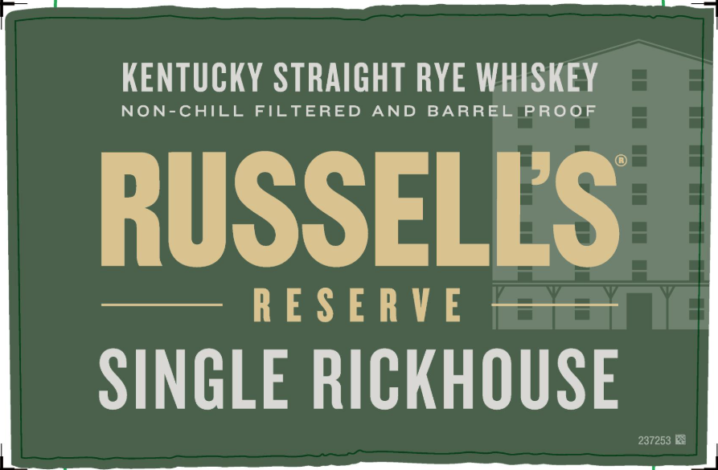
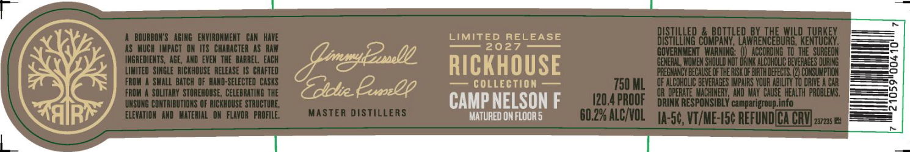
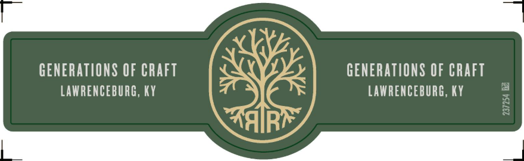

# TTB COLA Label Images - TTBID 26322001000134

**Brand Name:** RUSSELL'S RESERVE

**Fanciful Name:** SINGLE RICKHOUSE

**Issue Date:** 11/23/2026

**Origin Code:** 22

**Product Class/Type:** 102

**Source:** [TTB Public COLA Registry](https://ttbonline.gov/colasonline/viewColaDetails.do?action=publicFormDisplay&ttbid=26322001000134)

## Label Images

### Label 1

### Label 2

### Label 3

## Extracted Label Text

*Text extracted via OCR - may contain errors*

*1 image(s) excluded: text did not meet readability threshold*

**Detected Proof:** 120.4

### Label 1

KENTUCKY STRAIGHT RYE WHISKEY

NON-CHILL FILTERED AND BARREL PROOF

RUSSELLS

—— RESERVE ===>

SINGLE RICKHOUSE

### Label 2

BOURDON"S   ABING   ENVIRONMEHT   CaM   HAVE
LImIted RELEASE
HISIHHER CO BUIILE
EAURE HEUHLB
BTHRLEY
As Much inpact On |tS   CHARACTeR AS Haw
2027
HOVERNMENT
IRNG
ACCORDING
IHe SURCEOH
INGREDIENTS , AGE,  ANd EVE ThE BAbREl, Each
UmeyeoDe
GENERL MoVex SHouICuT DaNX LCOHQUCBTVERLGES DURING
LIMITED   SINGLE   RICKHOUSE   Release IS CRAFTED
RICKHQUSE
PREENANCY BECAUSE OF THE RUSK _F BIRTHDEFECTS
CONSUMPTON
FROL
shaLL BATCH  OF HAND-SELECTED   CaSKS
Tdte Eeo
750 ML
QF ACOHOLC BEVERACES [PARS YOUR  oIN
DRWE LCRR
FROM
SOlITARY  STOREHOUSE,  CeleBRATING The
OR OPERATe ^ MCHINERY, AND  MAY  CAUSE  HEALTH  PROBLeMS ,
8
UNSUNG CONTRIDUTIONS QF AICKHQUSE StRUCTURE;
CAMP NELSON F
120.4 PROOF
DRINK RESPONSIBLY camparigroupinfo_
elevation And   Watebial  On  FLAVOR  prOfILE:
MAStER DIStiLLers
MATURED ON FLOOR 5
60.2% ALCIVOL
Ia-56, VT/mE-|54 REFUNDEECRD
237235 0
