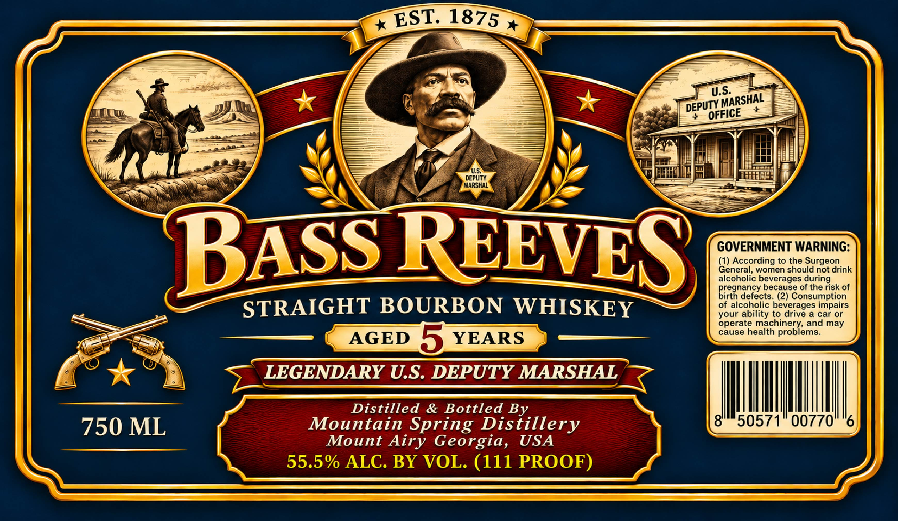
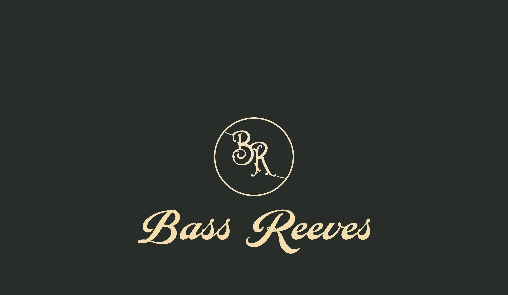

# TTB COLA Label Images - TTBID 26322001000160

**Brand Name:** BASS REEVES

**Issue Date:** 11/23/2026

**Origin Code:** 08

**Product Class/Type:** 101

**Source:** [TTB Public COLA Registry](https://ttbonline.gov/colasonline/viewColaDetails.do?action=publicFormDisplay&ttbid=26322001000160)

## Label Images

### Label 1

### Label 2

## Extracted Label Text

*Text extracted via OCR - may contain errors*

*1 image(s) excluded: text did not meet readability threshold*

**Detected Proof:** 111
**Detected Age:** 5 Years

### Label 1

1875
US
DEPUTY
MARSHAL
BASS REEVES
GOVGERNingN The ARgong:
General
women should not drink
alcoholic beverages during
because of the risk of
Bregraececbeczyseonshenpslo
STRAIGHT BOURBON WHISKEY
of alcoholic beverages impairs
your ability to drive a car or
operate machinery, and may
cause health problems.
AGED
5
YEARS
LEGENDARY US. DEPUTY MARSHAL
Distilled & Bottled By
750 ML
Mountain Spring Distillery
87
50571
00770
6
Mount
Georgia,
USA
55.5% ALC. BY VOL: (111 PROOF)
EST:
U.S:
MARSHAL
DEPUTY _
OFFICE
Airy
