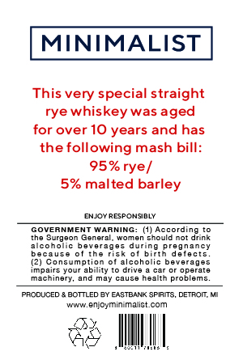
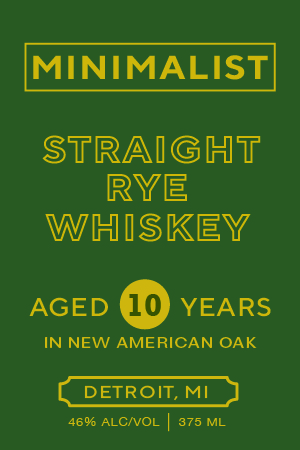

# TTB COLA Label Images - TTBID 26322001000267

**Brand Name:** M

**Fanciful Name:** 10 YEAR OLD STRAIGHT RYE WHISKEY

**Issue Date:** 11/23/2026

**Origin Code:** 06

**Product Class/Type:** 102

**Source:** [TTB Public COLA Registry](https://ttbonline.gov/colasonline/viewColaDetails.do?action=publicFormDisplay&ttbid=26322001000267)

## Label Images

### Back Label

### Front Label

## Extracted Label Text

*Text extracted via OCR - may contain errors*

**Detected Age:** 10 Years

### Back Label

This very special straight
rye whiskey was aged
for over 10 years and has
the following mash bill:
B%rye/

5% malted barley
uo esponsiy
fhe Sargoos General women voodld not eink
tS ‘Goncumption of sicohelie boverages
imachinely, and may cause health probleme
PRODUCED a BOTTED BY EASTBAM SPATS, DETROT
‘ww enoymmalt com
2S IM

PA

### Front Label

MINIMALIST
STRAiGHT
RYE
WHISKEY
AGED (10,
YEARS
IN NEW AMERICAN OAK
DETROIT, MI
4690 ALCIVOL
375 ML
