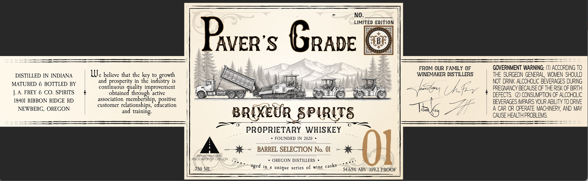

# TTB COLA Label Images - TTBID 26322001000300

**Brand Name:** BRIXEUR SPIRITS

**Fanciful Name:** PAVERS GRADE

**Issue Date:** 11/24/2026

**Origin Code:** 38

**Product Class/Type:** 140

**Source:** [TTB Public COLA Registry](https://ttbonline.gov/colasonline/viewColaDetails.do?action=publicFormDisplay&ttbid=26322001000300)

## Label Images

### Label 1

## Extracted Label Text

*Text extracted via OCR - may contain errors*

**Detected Proof:** 109.3

### Label 1

NO.
LIMITED EDITION
PvER s GRADE
FROM OUR FAMILY OF
GOVERNMENT WARNING:
ACCORDING TO
DISTILLED IN INDIANA
1U
believe that the
to
WINEMAKER DISTILLERS
THE SURGEON GENERAL, WOMEN  SHOULD
MATURED & BOTTLED BY
and prosperity in the
is
NOT  DRINK ALCOHOLIC BEVERAGES DURING
continuous
improvement
PREGNANCY BECAUSE OF THE RISK OF BIRTH
J.A. FREY & CO. SPIRITS
through . active
DEFECTS.
(2) CONSUMPTION OF ALCOHOLIC
18401 RIBBON RIDCE RD
association
memberghip;
BEVERAGES IMPAIRS YOUR ABILITY TO DRIVE
customer
relationships;' education
NEWBERG, ORECON
and
BRIXEUR
clum
A CAR OR OPERATE MACHINERY, AND MAY
SPIRETS
CAUSE HEALTH PROBLEMS.
PROPRIETARY
WHISKEY
FOUNDED IN 2020
BARREL SELECTION No. 01
01
ASPHALI PAVEMENI
ASSOCIATION OF ORECON
OREGON DISTILLERS
750 ML
aged in
series of wine casks
54.65% ABV /109.3 PROOF
key
growth
indistry
ibtainediuality'
positive
training:
unique
