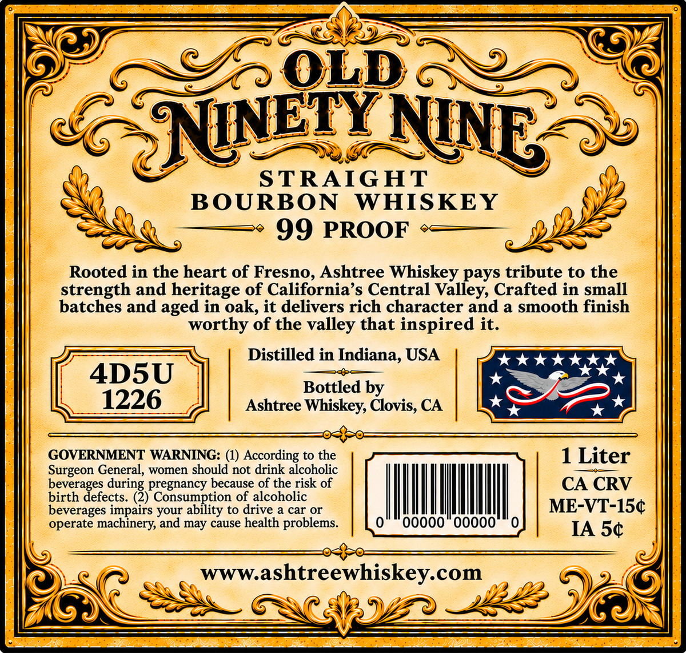
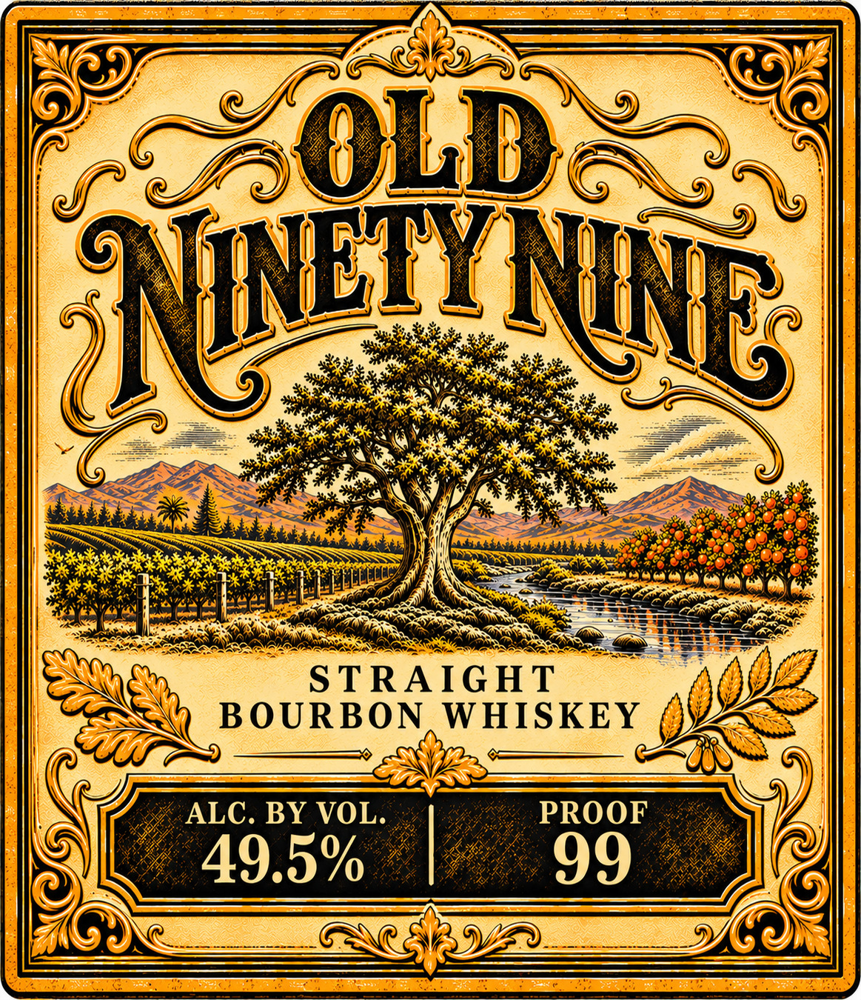

# TTB COLA Label Images - TTBID 26322001000309

**Brand Name:** OLD NINETY NINE

**Issue Date:** 11/23/2026

**Origin Code:** 01

**Product Class/Type:** 101

**Source:** [TTB Public COLA Registry](https://ttbonline.gov/colasonline/viewColaDetails.do?action=publicFormDisplay&ttbid=26322001000309)

## Label Images

### Back Label

### Front Label

## Extracted Label Text

*Text extracted via OCR - may contain errors*

**Detected Proof:** 99

### Back Label

2 OLD
NNEIY
STRAIG HT
BOURBON
WHISKEY
99 PROOF
Rooted in the heart of Fresno, Ashtree Whiskey pays tribute to the
strength and heritage of California s Central Valley, Crafted in small
batches and aged in oak, it delivers rich character and a smooth finish
worthy of the valley that inspired it.
Distilled in Indiana, USA
4DSU
Bottled by
1226
Ashtree Whiskey, Clovis, CA
GOVERNMENT WARNING: (1) According to the
IL
Liter
Surgeon General, women should not drink alcoholic
beverages
pregnancy because of the risk of
CA CRV
birth defects.
Consumption of alcoholic
beverages
your ability to drive & car Or
ME-VT-ISc
operate
Sachpery; '
and may cause health problems
IA 5c
wwwashtreewhiskey com
NNE
during_

### Front Label

OLD
NWciyNWNE
S TRAIGHT
BOURBON_
WHISKEY
ALC: BY VOL.
PROOF
49.5%
99
