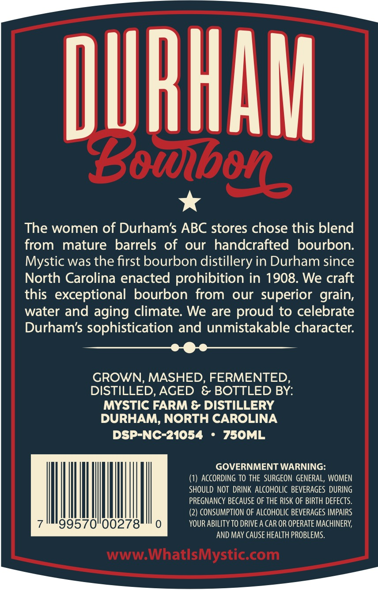
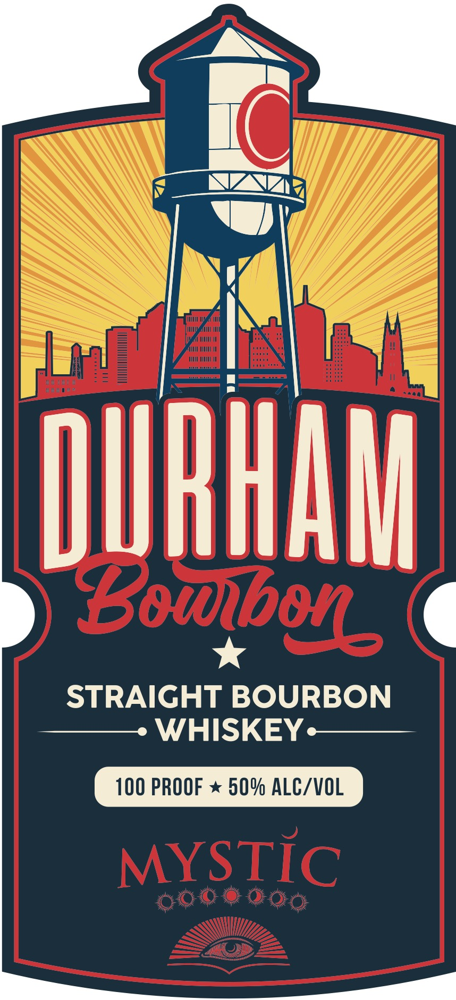

# TTB COLA Label Images - TTBID 26322001000446

**Brand Name:** DURHAM BOURBON

**Issue Date:** 11/23/2026

**Origin Code:** 35

**Product Class/Type:** 101

**Source:** [TTB Public COLA Registry](https://ttbonline.gov/colasonline/viewColaDetails.do?action=publicFormDisplay&ttbid=26322001000446)

## Label Images

### Back Label

### Label 1

## Extracted Label Text

*Text extracted via OCR - may contain errors*

**Detected Proof:** 100

### Back Label

IIRHM
The women of Durham's ABC stores chose this blend
from
mature
barrels of our  handcrafted
bourbon:
Mystic was the first bourbon distillery in Durham since
North Carolina enacted prohibition in 1908. We craft
this   exceptional bourbon from
our
superior grain,
water and aging climate. We are proud to celebrate
Durham's sophistication and unmistakable character:
GROWN, MASHED, FERMENTED
DISTILLED, AGED
& BOTTLED BY:
MYSTIC FARM & DISTILLERY
DURHAM; NORTH CAROLINA
DSP-NC-21054
75OML
GOVERNMENT WARNING:
(1) AcCORDING TO THE  SURGEON  GENERAL, WOMEN
SHOULD  NOT  DRINK  aLCoHOLIC BEVERAGES DURING
PREGNANCY BECAUSE OF THE RISK OF BIRTH DEFECTS.
(2) CONSUMPTION OF aLCoHOLIc BEVERAGES IMPAIRS
99570"00278
YOUR ABILlITy TO DRIVE A CAR OR OPERATE MACHINERY;
AND MAy CAUSE HEALTH PROBLEMS.
WWW.WhatlsMystic com

### Label 1

bha
STRAIGHT BOURBON
WHISKEY
100 PROOF
509 ALC/VOL
MYSTic
