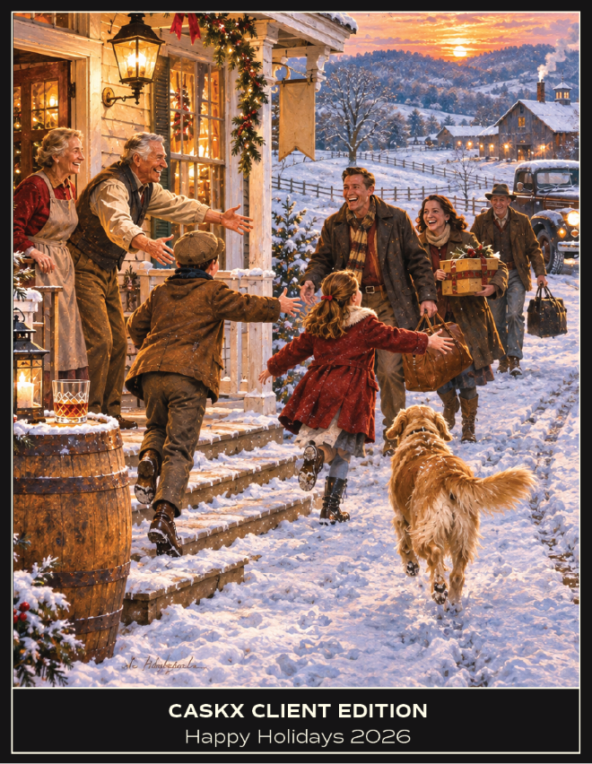
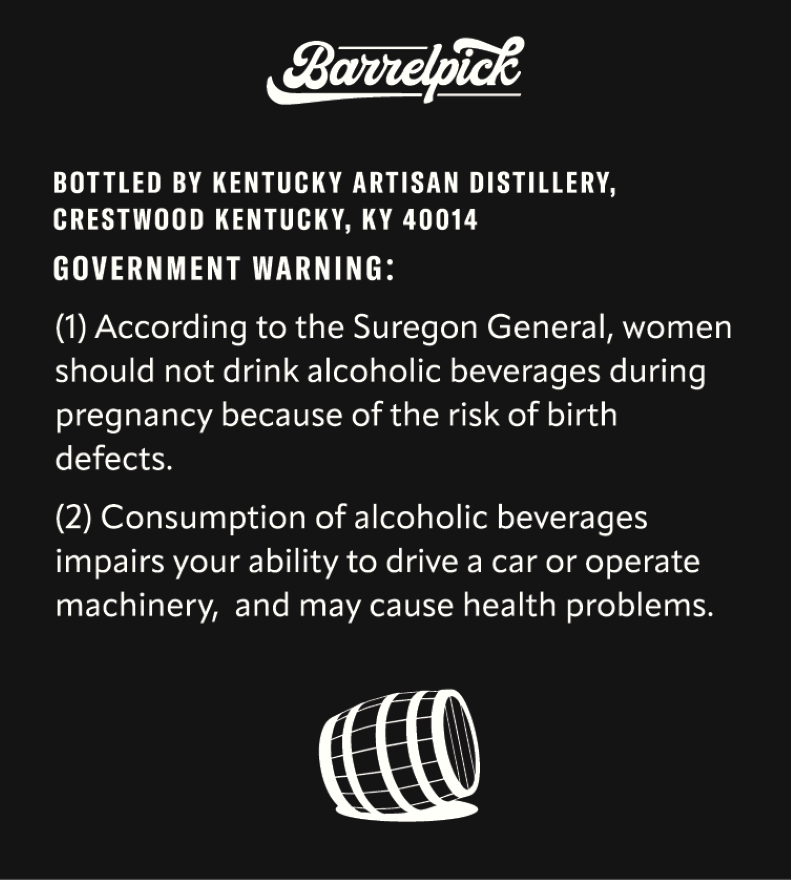

# TTB COLA Label Images - TTBID 26322001000530

**Brand Name:** BARRELPICK

**Issue Date:** 11/23/2026

**Origin Code:** 22

**Product Class/Type:** 141

**Source:** [TTB Public COLA Registry](https://ttbonline.gov/colasonline/viewColaDetails.do?action=publicFormDisplay&ttbid=26322001000530)

## Label Images

### Front Label

### Label 2

### Label 3

## Extracted Label Text

*Text extracted via OCR - may contain errors*

*1 image(s) excluded: text did not meet readability threshold*

### Front Label

CASKX CLIENT EDITION
Happy Holidays 2026

### Label 3

Barvrelpick
BOTTLED BY KENTUCKY ARTISAN DISTILLERY,
CRESTWOOD KENTUCKY, KY 40014
GOVERNMENT WARNING:
(1) According to the Suregon General, women
should not drink alcoholic beverages during
pregnancy because of the risk of birth
defects.
(2) Consumption of alcoholic beverages
impairs your ability to drive a car or operate
machinery, and may cause health problems.
tf

CA

waGe

WAS
