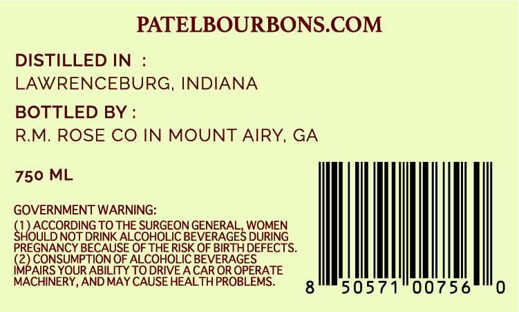
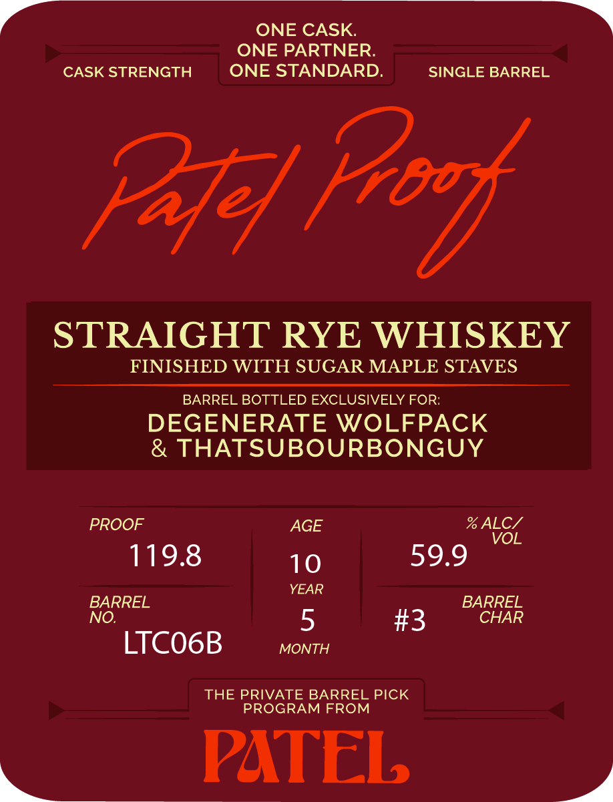

# TTB COLA Label Images - TTBID 26322001000708

**Brand Name:** PATEL PROOF

**Issue Date:** 11/23/2026

**Origin Code:** 08

**Product Class/Type:** 102

**Source:** [TTB Public COLA Registry](https://ttbonline.gov/colasonline/viewColaDetails.do?action=publicFormDisplay&ttbid=26322001000708)

## Label Images

### Back Label

### Label 1

## Extracted Label Text

*Text extracted via OCR - may contain errors*

### Back Label

PATELBOURBONS.COM

DISTILLED IN

LAWRENCEBURG, INDIANA

BOTTLED BY

R.M. ROSE CO IN MOUNT AIRY, GA

750 ML

GOVERNMENT WARNING:

ACCORDING TO THE SURGEON GENERAL, WOMEN

g

ULD NOT DRINK ALCOHOLIC BEVERAGES DURING

PREGNANCY BECAUSE OF THE RISK OF BIRTH DEFECTS.

CONSUMPTION OF ALCOHOLIC BEVERAGES

Wie

"AIRS YOUR ABILITY TO DRIVE A CAR OR OPERATE

MACHINERY, AND MAY CAUSE HEALTH PROBLEMS.

ult

### Label 1

ONE CASK
ONE PARTNER.
CASK STRENGTH
ONE STANDARD.
SINGLE BARREL
afe
STRAIGHT RYE WHISKEY
FINISHED WITH SUGAR MAPLE STAVES
BARREL BOTTLED EXCLUSIVELY FOR:
DEGENERATE WOLFPACK
THATSUBOURBONGUY
PROOF
AGE
% ALC/
VOL
119.8
10
59.9
YEAR
BARREL
BARREL
NO.
5
#3
CHAR
LTCO6B
MONTH
THE PRIVATE BARREL PICK
PROGRAM FROM
PATEL
Yrbo f
