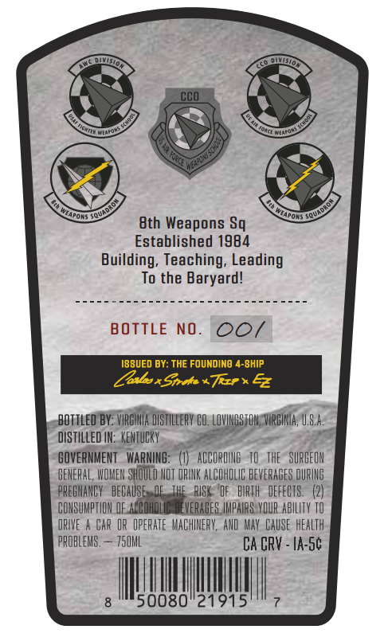
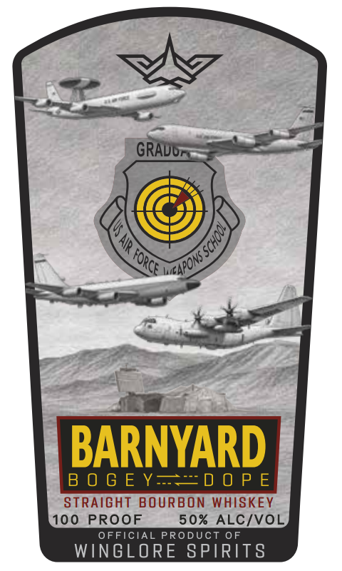

# TTB COLA Label Images - TTBID 26322001000773

**Brand Name:** WINGLORE SPIRITS

**Fanciful Name:** BARNYARD BOGEY DOPE

**Issue Date:** 11/24/2026

**Origin Code:** 05

**Product Class/Type:** 101

**Source:** [TTB Public COLA Registry](https://ttbonline.gov/colasonline/viewColaDetails.do?action=publicFormDisplay&ttbid=26322001000773)

## Label Images

### Back Label

### Front Label

## Extracted Label Text

*Text extracted via OCR - may contain errors*

**Detected Proof:** 100

### Back Label

CCO
"io wendl
Bth Weapons Sq
Established 1984
Building, Teaching, Leading
To the Baryard!
BOTTLE NO_
00/
IBBUED BY: THE FOUNDINO 4-8HIP
ZeshoxSneke*Tror* Ez
BOTTLED BY: VIRGIA DISTILLEPY BO. LOVINGSTIM, VIRBIMA , U,SA.
distILled IM:  KENTUEKY
GOVERNMENT   WARNING:
ACCOPIING   TO   THE   SURBEOM
BEHEFAL, WOHEN SHOULO MOT OPINK ALCOHOLIC FeverageS OUFIG
PPEGMANCY   HECAUSE
RISK
IF   FIRTH   OFFECTS.
CONSUMPTHOM OF ALBOhOlu
EveRabeS IpHIRS YQUP HBLLITK TO
OPIVE
CAR  Ruperate   MACHINERY,  AWDMAY  CAUSF  heALTH
PROBLEMS,
7501L
CA CRV - Ia-Sc
50080"21915
Mea7ors

### Front Label

BARNYARD

STRAIGHT BOURBON WHISKEY

100 PROOF 50% ALC/VOL
OFFICIAL PRODUCT OF

WINGLORE SPIRITS
