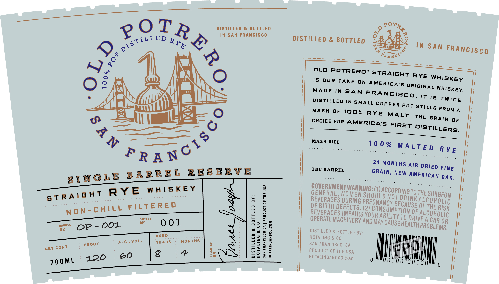

# TTB COLA Label Images - TTBID 26323001000236

**Brand Name:** OLD POTRERO

**Fanciful Name:** SINGLE BARREL RESERVE

**Issue Date:** 11/24/2026

**Origin Code:** 02

**Product Class/Type:** 102

**Source:** [TTB Public COLA Registry](https://ttbonline.gov/colasonline/viewColaDetails.do?action=publicFormDisplay&ttbid=26323001000236)

## Label Images

### Label 1

## Extracted Label Text

*Text extracted via OCR - may contain errors*

### Label 1

OT

DISTILLED & BOTTLED

POT,

e

IN SAN FRANCISCO

qibLED ve

DISTILLED & BOTTLED afk

vit

+ —~—

Rane

4?

IN SAN FRANCIScg

oO

pata te

Mt

2

ee

xe

OLD POTRERD:?

STRAIGHT RY

iit

E WHISKEy

i

1S OUR TAKE oN AMERICA’S ORIG!

NAL WHISKEy.

=

&

MADE IN SAN FRANCISCO,

IT Is TWICE

al

DISTILLED IN SMALL COPPER por s

IAS

TILLS FRom q

Las

MASH OF 100% RYE MALT—1

CHOICE FoR AMERICA’S FIRST

HE GRAIN OF

DISTILLERS

MASH BILL

100% m

ALTED Rye

roth

ON EEE re

He

FRAN

24 MONTHS AIR DRIED FINE

THE BARREL

sINGLE B

Sogeesee ethene eee y ye)

GRAIN, NEw AMERICAN OAK,

Oa.

GOVERNMENT WARNING:

(1)

ACCORDING To TH

ut RYE WHISKEY

BEVERAGES D

GENERAL, WOMEN §

L

OT DRI

ESURGEON

OF BIRTH DEF

URING PREGNANC

Y BECAUSE

ALCOHOLIC

NON-CHILL F

ILTERED

ECTS. (2

) CONSU

PTI

OF THE RISK

A

BOTTLE

BEVERAGES IMPAIRS Y

0

UR ABILITY TO DRIVE

Lt

O01

maO zs

OPERATE MACHINERY, AN

D MAY CAUSE HEALTH P

LOHOLIC

a” OP - OOL

Zeos

oss

ROBLEMS,

AGED

mofo

og

DISTILLED & BOTTLED By

HOTALING & CO

PROOF

ALC./VOL.

YEARS

MONTHS

oasz2z

4uZ2ce

=z

ET CONT

ane

eFtGkSa

==

SAN FRANCISCO, CA

ie

o@

aronz

= ors

=o

PRODUCT OF THE USA

HOTALINGANDCO.com

90000"000g
