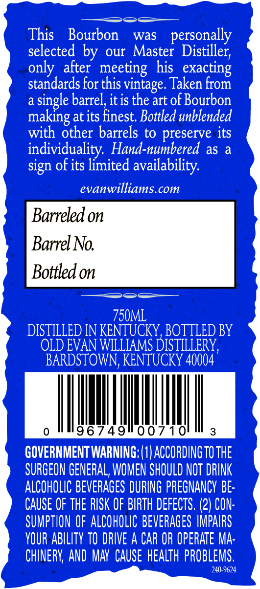
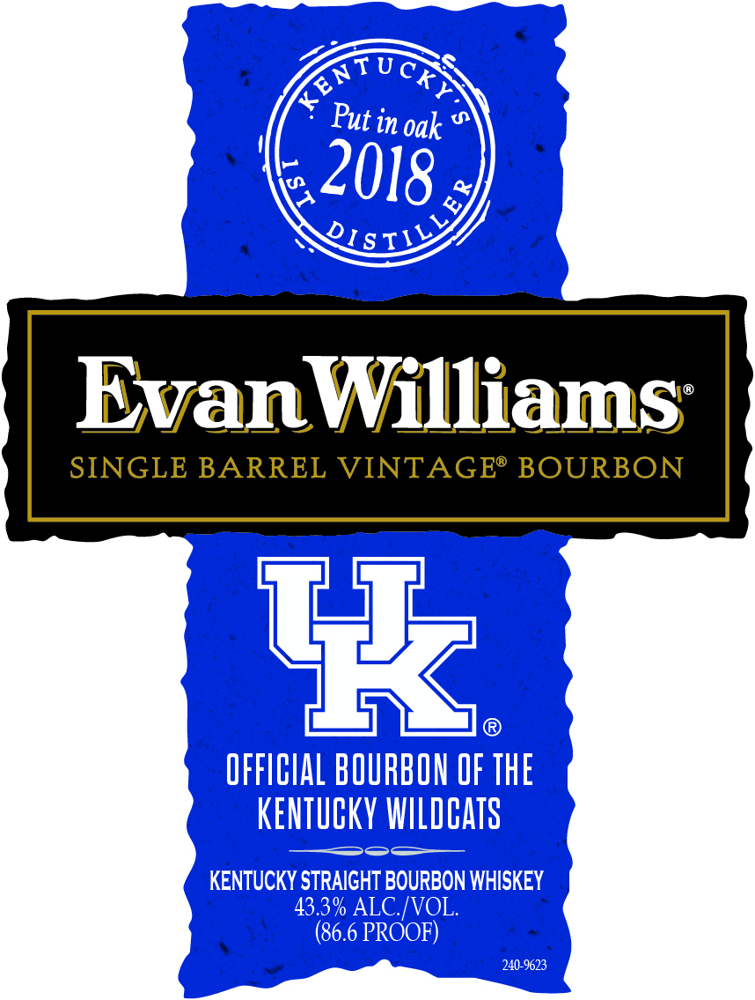

# TTB COLA Label Images - TTBID 26323001000244

**Brand Name:** EVAN WILLIAMS

**Fanciful Name:** SINGLE BARREL UK EDITION

**Issue Date:** 11/24/2026

**Origin Code:** 22

**Product Class/Type:** 101

**Source:** [TTB Public COLA Registry](https://ttbonline.gov/colasonline/viewColaDetails.do?action=publicFormDisplay&ttbid=26323001000244)

## Label Images

### Back Label

### Front Label

## Extracted Label Text

*Text extracted via OCR - may contain errors*

**Detected Proof:** 86.6

### Back Label

This
Bourbon
was
personally
selected by our Master  Distiller;
only, after  meeting  his _ exacting
standards for this vintage: Taken from
a
single barrel;it is the art of Bourbon
atits finest Bottled unblended
with other barrels to preserve its
Sgi odualimitedr
Hand-numbered as
a
Sign of its
availability:
evanwilliams.com
Barreled on
Barrel No
Bottled on
750ML
DISTILLED IN KENTUCKY, BOTTLED BY
OLD EVAN WILLIAMS DISTILLERY
BARDSTOWN, KENTUCKY 40004
GOVERNMENT WARNING: (1| ACCORDING TO ThE
SURGEON GENERAL, WOMEN SHOULD NOT DRINK
ALCOHOLIC BEVERAGES DURING PREGNANCY Be:
CAUSE OF THE RISK OF BIRTH DEFECTS. (2) CON:
SUMPTION OF ALCOHOLIC beverAGES IMPAIRS
YOUR ABILITY TO DRIVE A CAR OR OpeRATe Ma:
CHINERV; AND MAV CAUSE  health  PROBLEMS.
240-9624
making

### Front Label

in oak
A
EvanWilliams
SINGLE BARREL VINTAGE? BOURBON
K
OFFICIAL BOURBON OF THE
keNTuCKY WILDCATS
KENTUCKY STRAICHT BOURBON WHISKEY
43.3% ALCIVOL
(86.6 PROOF)
240-9623
TuckY
FEN
Put i
2018
QISILLLY
