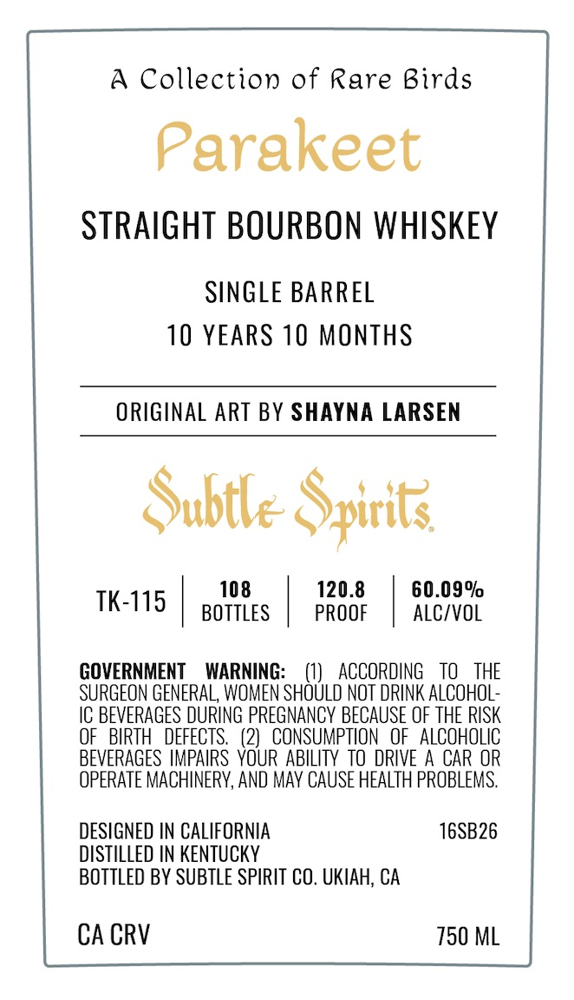
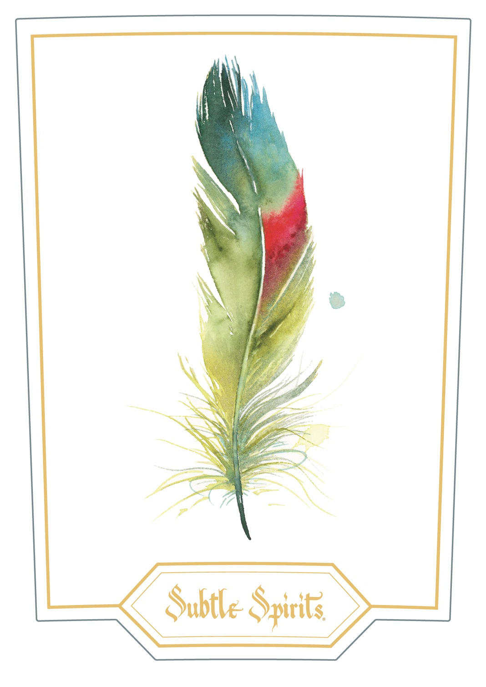

# TTB COLA Label Images - TTBID 26323001000292

**Brand Name:** SUBTLE SPIRITS

**Fanciful Name:** PARAKEET

**Issue Date:** 11/24/2026

**Origin Code:** 01

**Product Class/Type:** 101

**Source:** [TTB Public COLA Registry](https://ttbonline.gov/colasonline/viewColaDetails.do?action=publicFormDisplay&ttbid=26323001000292)

## Label Images

### Back Label

### Front Label

## Extracted Label Text

*Text extracted via OCR - may contain errors*

*1 image(s) excluded: text did not meet readability threshold*

**Detected Proof:** 120.2
**Detected Age:** 10 Years

### Back Label

Collection of Rare Birds
Parakeet
STRAIGHT BOURBON WHISKEY
SINGLE BARREL
10 YEARS 10 MONTHS
ORIGINAL ART BY SHAYNA LARSEN
Subtle
108
120.8
60.09%
TK-115
BOTTLES
PROOF
ALC/VOL
GOVERNMENT
WARNING:
(U)
ACCORDING
TO
THE
SURGEON GENERAL; WoMEn SHOULD NOT DRINK ALCOHOL-
IC BEVERAGES DURING PREGNANCY BECAUSE OF THE RISK
OF   BIRTH   DEFECTS .   (2)   CONSUMPTION
OF   ALCOHOLIC
BEVERAGES IMPAIRS YOUR ABILITY To DRIVE A CAR OR
OPERATE MAChINERY, AND Mav CAUSE HEALTH PROBLEMS:
DESIGNED IN CALIFORNIA
16SB26
DISTILLED IN KENTUCKY
BOTTLED BY SUBTLE SPIRIT CO. UKIAH; CA
CA CRV
750 ML
Spirits
