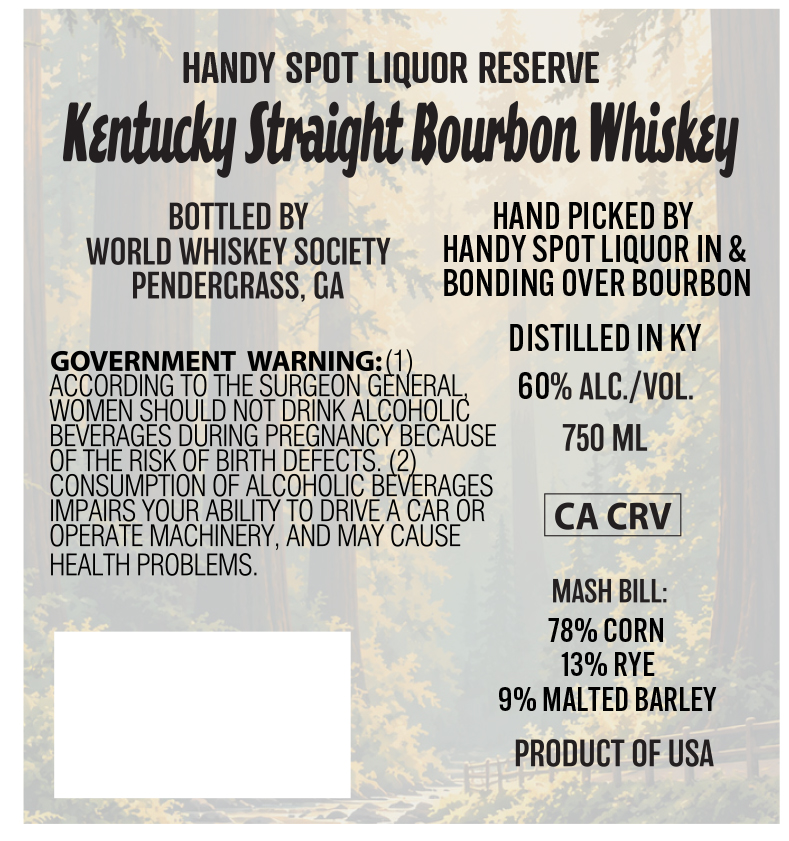
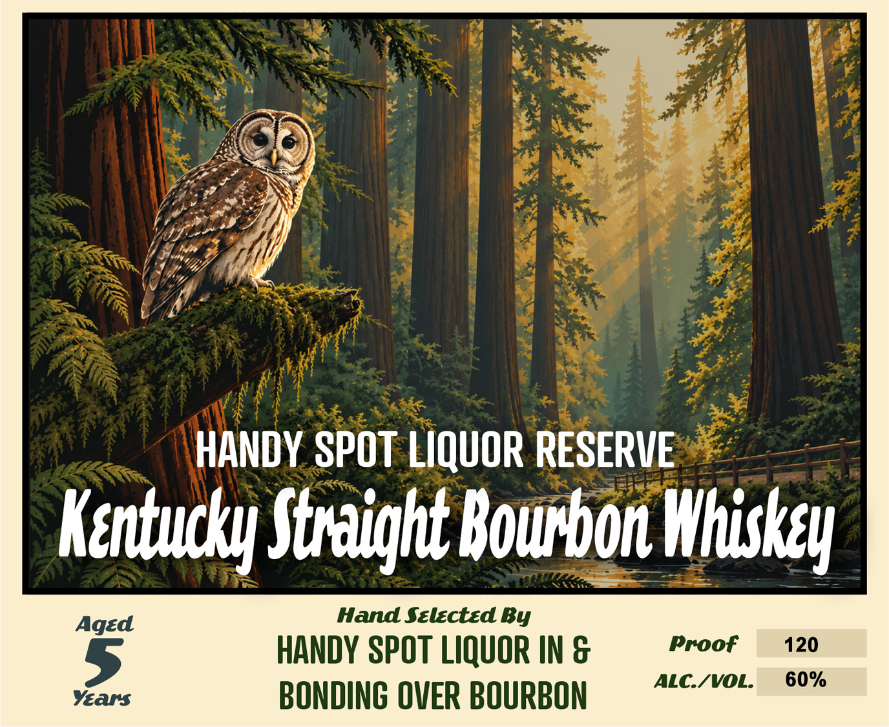

# TTB COLA Label Images - TTBID 26323001000296

**Brand Name:** HANDY SPOT LIQUOR RESERVE

**Issue Date:** 11/24/2026

**Origin Code:** 08

**Product Class/Type:** 101

**Source:** [TTB Public COLA Registry](https://ttbonline.gov/colasonline/viewColaDetails.do?action=publicFormDisplay&ttbid=26323001000296)

## Label Images

### Back Label

### Front Label

## Extracted Label Text

*Text extracted via OCR - may contain errors*

**Detected Proof:** 120

### Back Label

HANDY SPOT LIQUOR RESERVE
Kentucky Straight Bourbon
BOTTLED BY
HAND PICKED BY
WORLD WHISKEY SOCIETY
HANDY SPOT LIQUOR IN &
PENDERCRASS, CA
BONDING OVER BOURBON
DISTILLED IN KY
GOVERNMENT WARNING:(1 =
ACCORDING TO THE SURGEON GENERAL
60% ALC./VOL.
WOMEN SHOULD Noj DRINK ALCOHOLiC
BEVERAGES DURING PREGNANCY BECAUSE
750 ML
QF THE RISK OF BIRTH DEFECTS
CONSUMPTION OF ALCOHOLIC BEVERAGES
IMPAIRS YOUR ABILITY TO DRIVE A CAR OR
CA CRV
OPERATE MACHINERY, AND MAY CAUSE
HEALTH PROBLEMS.
MASH BILL:
78% CORN
139 RYE
9% MALTED BARLEY
PRODUCT OF USA
Whisksy

### Front Label

HANDY SPOT LIQUOR RESERVE
Kentucky Straight Bowbon
Aged
Hand Selected By
5
HANDY SPOT LIQUOR IN &
Proof
120
ALC/ VOL:
60%
Years
BONDING OVER BOURBON
Whiskey
