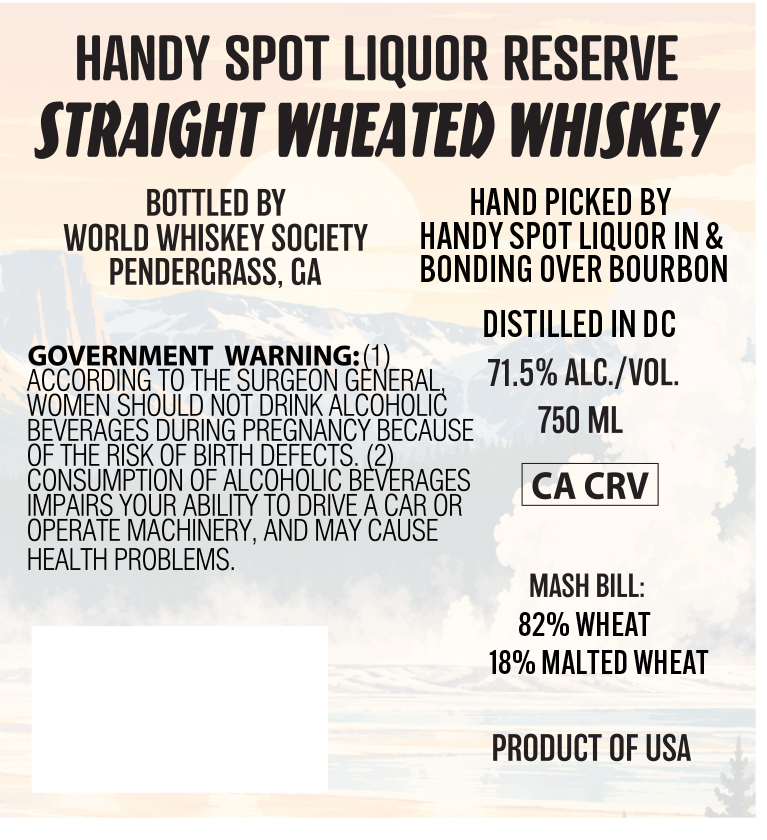
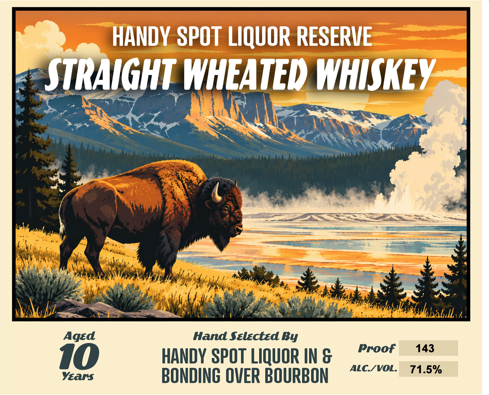

# TTB COLA Label Images - TTBID 26323001000310

**Brand Name:** HANDY SPOT LIQUOR RESERVE

**Issue Date:** 11/24/2026

**Origin Code:** 08

**Product Class/Type:** 109

**Source:** [TTB Public COLA Registry](https://ttbonline.gov/colasonline/viewColaDetails.do?action=publicFormDisplay&ttbid=26323001000310)

## Label Images

### Back Label

### Front Label

## Extracted Label Text

*Text extracted via OCR - may contain errors*

**Detected Proof:** 143

### Back Label

HanDY SPOT LIQUOR RESERVE
STRAIGHT WHEATED WHISKEY
BOTTLED BY
HAND PICKED BY
WORLD WhISKEY SOCIETY
HANDY SPOT LIQUOR IN &
PENDERCRASS, CA
BONDING OVER BOURBON
DISTILLED IN DC
GOVERNMENT WARNING:(1
ACCORDING TO THE SURGEON GENERAL
71.5% ALC /VOL,
WOMEN SHOULD NoT DRINK ALCOHOLIC
750 ML
BeVE4955.8F2T PBeGEciSV BEcAUsE
THE RISK OF BIRTH DEFECTS (2)
CONSUMPTION OF ALCOHOLIC BEVRAGES
CA CRV
IMPAIRS_YOUR ABILITY TO DRIVE A CAR_OR
OPERATE MACHINERY, AND MAY CAUSE
HEALTH PROBLEMS.
MASH BILL:
82% WHEAT
18% MALTED WHEAT
PRODUCT OF USA

### Front Label

HANDY SPOT LIQUOR RESERVE
STRAIGHT WHEATED WHISKEY
Aged
Hand Selected By
Proof
143
10
HANDY SPOT LIQUOR IN &
ALC_/ VOL:
71.5%
Years
BONDING OVER BOURBON
