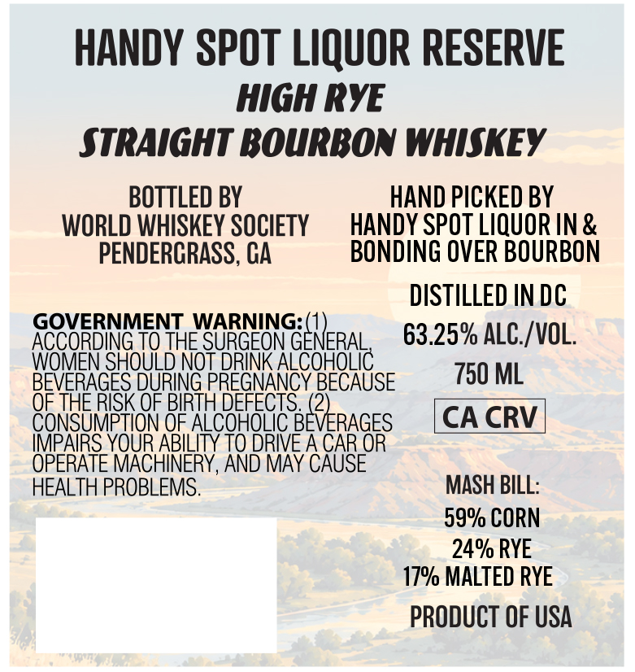
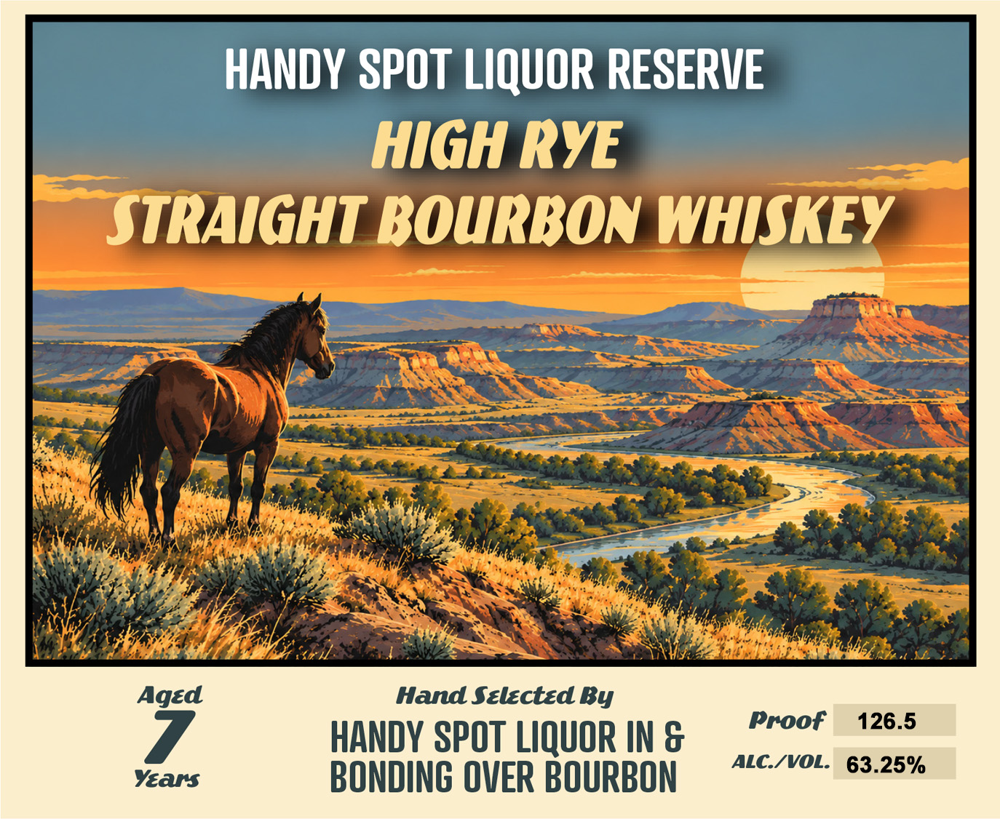

# TTB COLA Label Images - TTBID 26323001000318

**Brand Name:** HANDY SPOT LIQUOR RESERVE

**Issue Date:** 11/24/2026

**Origin Code:** 08

**Product Class/Type:** 101

**Source:** [TTB Public COLA Registry](https://ttbonline.gov/colasonline/viewColaDetails.do?action=publicFormDisplay&ttbid=26323001000318)

## Label Images

### Back Label

### Front Label

## Extracted Label Text

*Text extracted via OCR - may contain errors*

**Detected Proof:** 126.5

### Back Label

HANDY SPOT LIQUOR RESERVE
HIGH RYE
STRAIGHT BOURBON WHISKEY
BOTTLED BY
HAND PICKED BY
WORLD WhISKEY SOCIETY
HANDY SPOT LIQUOR IN &
PENDERCRASS, CA
BONDING OVER BOURBON
DISTILLED IN DC
GOVERNMENT WARNING:
ACCORDING TO THE SURGEON GENERAL
63.25% ALC/VOL.
WOMEN SHOULD NOT DRINK ALCOHOLIC
BEVERAGES DURING PREGNANCY BECAUSE
750 ML
OF THE RISK OF BIRTH DEFECTS
21
CONSUMPTION OF ALcOHOLIc BEVERAGES
CA CRV
IMPAIRS YOUR ABILITY TO DRIVE A CAR OR
OPERATE MACHINERY, AND MAY CAUSE
HEALTH PROBLEMS.
MASH BILL:
599 CORN
249 RYE
17% MALTED RYE
PRODUCT OF USA

### Front Label

HANDY SPOT LIQUOR RESERVE
HIGH RYE
STRAIGHT BOURBON WHISKEY
Aged
Hand Selected By
Proof
126.5
HANDY SPOT LIQUOR IN &
ALC./VOL:
63.25%
Years
BONDING OVER BOURBON
