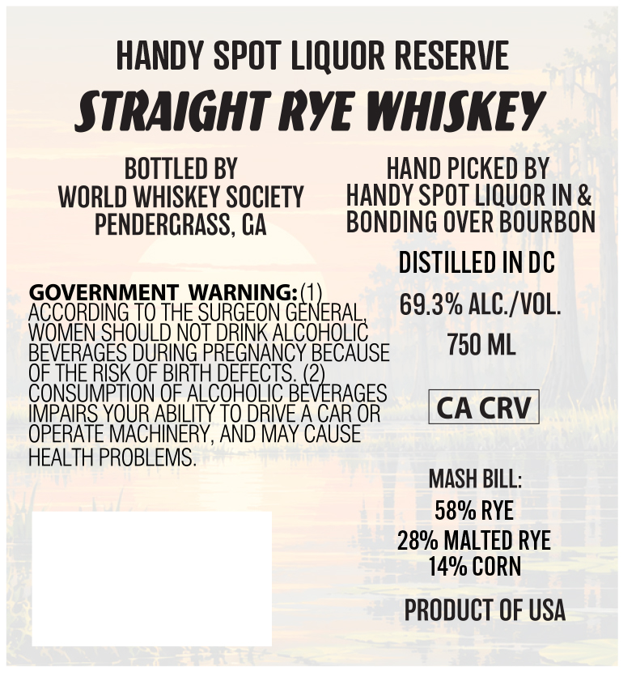
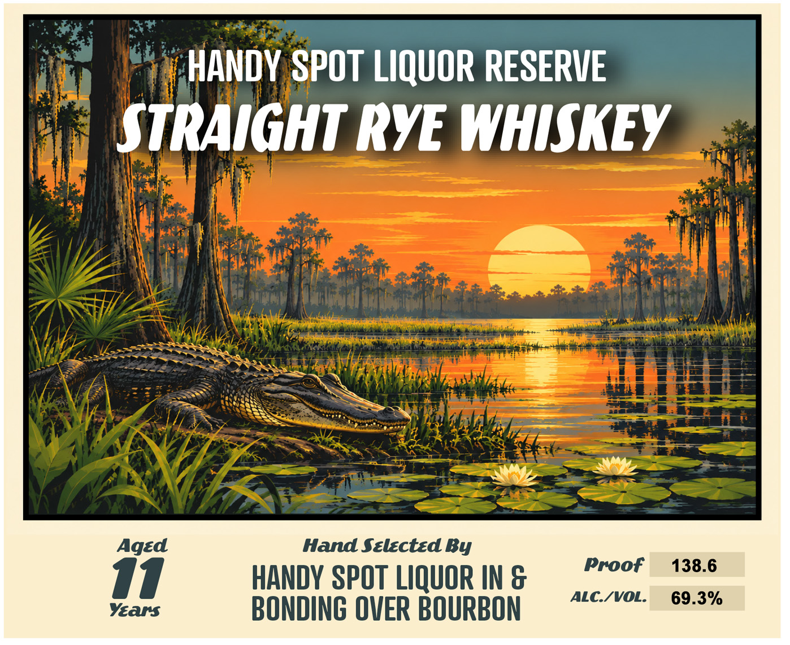

# TTB COLA Label Images - TTBID 26323001000326

**Brand Name:** HANDY SPOT LIQUOR RESERVE

**Issue Date:** 11/24/2026

**Origin Code:** 08

**Product Class/Type:** 102

**Source:** [TTB Public COLA Registry](https://ttbonline.gov/colasonline/viewColaDetails.do?action=publicFormDisplay&ttbid=26323001000326)

## Label Images

### Back Label

### Front Label

## Extracted Label Text

*Text extracted via OCR - may contain errors*

**Detected Proof:** 138.6

### Back Label

HANDY SPOT LIQUOR RESERVE
STRAIGHT RYE WHISKEY
BOTTLED BY
HAND PICKED BY
WORLD WwhISKEY SOCIETY
HanDy SPOT LIQUOR IN &
PENDERGRASS; GA
BONDING OVER BOURBON
DISTILLED IN DC
GOVERNMENT WARNING:
69,3% ALC./VOL.
ACCORDING TO THE SURGEON GENERAL
WOMEN SHOULD Not DRINK ALCOHOLIC
DURING PREGNANCY BECAUSE
750 ML
BeVFA9S
THE RISK OF BIRTH DEFECTS
2
CONSUMPTION OF ALCOHOLIC BEVRAGES
IMPAIRS YOUR ABILITY TO DRIVE A CAR OR
CA CRV
OPERATE MACHINERY, AND MAY CAUSE
HEALTH PROBLEMS.
MASH BILL:
589 RYE
289 MALTED RYE
149 CORN
PRODUCT OF USA

### Front Label

HANDV SPOT LIQUOR RESERVE
STRAIGHT RYE WHISKEY
Aged
Hand Selected By
Proof
138.6
11
HANDY SPOT LIQUOR IN &
ALC./VOL.
69.3%
Years
BONDING OVER BOURBON
